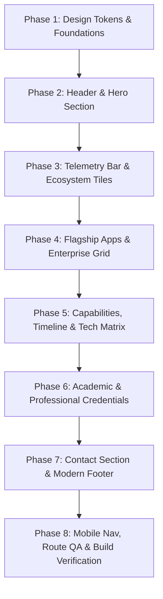

# Master Implementation Plan: Next-Gen Obsidian Cyber-Glass Portfolio
> **Branch:** `feature/modern-obsidian-portfolio`  
> **Source Design:** `mobile_engineer_portfolio_landing/` (Exported from Stitch AI)  
> **Target Role:** MD Tanvir Shaharia — Senior Mobile Architect (Android Native & Flutter Specialist)  
> **Status:** Architecture & Component Blueprint Ready  

---

## 🔍 PART 1: COMPREHENSIVE UI AUDIT (EXPORTED STITCH DESIGN)

### 1.1 What Is 100% Ready & Visually Outstanding
1. **Design System & Aesthetics:**
   - Palette is unified around **Obsidian Cyber-Glass** (`#09090b` canvas, `#6366f1` Electric Indigo, `#06b6d4` Cyber Cyan, `#10b981` Emerald live indicator).
   - Ambient background features radial glow orbs (`blur-[130px]`) and a subtle $4\text{rem}\times4\text{rem}$ cyber grid mask.
   - Frosted glass cards (`backdrop-blur-xl`, `border border-white/10`) provide tactile depth without visual clutter.
2. **Hero Section (2-Column Asymmetric):**
   - Left side: Pulsing live status pill, large gradient headline (`MD Tanvir Shaharia`), descriptive role subtitle (`> Senior Software Engineer [Android Native & Flutter]`), 3 clear CTAs.
   - Right side: $4:5$ ratio portrait card with specular light line, ambient neon halo, and 2 floating glass telemetry cards (`10+ Apps Shipped`, `Clean Architecture & Offline-First`).
3. **Telemetry Metrics Bar:**
   - 4-column high-contrast counters: `3+ Yrs Experience`, `10+ Apps Shipped`, `5M+ Users Reach`, `100% Offline-First Core`.
4. **Enterprise & Scale Strip:**
   - 6 partner/client tiles: My Robi (10M+ Users), My Airtel BD, Nascenia Ltd, Shojja Hospital, Industrial BLE IoT, CZM/Biyeta.
5. **Product & Telecom Architecture:**
   - 2 deep flagship cards: **PocketLog** (Google Play certified, 14 currencies, Room DB, Canvas A4 PDF) & **Trade Memo** (KMP, Compose Multiplatform, Avoidable Loss engine).
   - 3 enterprise client cards: My Robi, My Airtel BD, Shojja Hospital.
6. **Capabilities & Career Journey:**
   - 3-card Bento for Native Android Compose, High-Throughput Flutter, and IoT / BLE Hardware Sync.
   - Vertical timeline with glowing nodes for Nascenia Limited and Independent App Publisher.
7. **Credentials (No Fake Feedback):**
   - 100% authentic: Left column (Northern University B.Sc. CSE + Rajshahi Polytechnic Diploma CGPA 3.54), Right column (Frontend Masters Prompt Engineering 2026 + Creative IT Android Certificate).
8. **Footer & Connectors:**
   - Replaced plain text lists with $44\times44\text{ px}$ squircle frosted glass icon buttons (GitHub, LinkedIn, Telegram, Google Play, Email) with neon hover glows.

### 1.2 Discrepancies & Adjustments Found in Exported `code.html`
| Item | Issue in Exported `code.html` | Implementation Fix in React |
| :--- | :--- | :--- |
| **Contact Form** | Line 622 in `code.html` accidentally duplicated the 4 Telemetry counters inside `<section id="contact">` instead of the form shown in `screen.png`. | We will implement the real "Let's Build Something Ultra-Reliable" contact card with active form inputs (EmailJS), direct WhatsApp pill, and email address. |
| **Profile Images** | Uses temporary Google AIDA / placeholder URLs (`https://lh3.googleusercontent.com/...`). | Wire up Tanvir's real local portrait `src/assets/images/tanvir_shaharia.png` and logo `src/assets/images/logo.webp`. |
| **Interactive Modals** | Stitch generated static CTA links (`href="#"`). | Connect PocketLog & Trade Memo to the existing interactive `AppModal` so visitors can view screenshots and deep architecture breakdowns. |
| **Icons & Fonts** | Uses Google Material Symbols and remote fonts via CDN. | Add Google Fonts (Plus Jakarta Sans, Inter, JetBrains Mono, Material Symbols) directly to `public/index.html` or `main.css`. |
| **Route Protection** | Needs to retain existing legal routes. | Preserve `/pocketlog/privacy` and `/pocketlog/terms` so Google Play Console compliance is unaffected. |

---

## 🛠️ PART 2: PHASE-BY-PHASE IMPLEMENTATION ROADMAP

---

### PHASE 1: Design Tokens & Foundations Setup
**Objective:** Configure Tailwind CSS and core stylesheets with Stitch's Obsidian Cyber-Glass token system.

* **Task 1.1: `tailwind.config.js` Expansion**
  - Add color tokens:
    * `surface-canvas`: `#09090b`
    * `surface-panel`: `#0f172a`
    * `surface-glass`: `rgba(15, 23, 42, 0.65)`
    * `surface-glass-subtle`: `rgba(255, 255, 255, 0.03)`
    * `border-glass`: `rgba(255, 255, 255, 0.10)`
    * `primary`: `#6366f1` / `#c0c1ff`
    * `secondary`: `#06b6d4` / `#4cd7f6`
    * `tertiary`: `#10b981` / `#4edea3`
    * `surface-container`: `#201f22`, `surface-container-high`: `#2a2a2c`
  - Register font families:
    * `display-hero`: `['Plus Jakarta Sans', 'sans-serif']`
    * `mono-tag`: `['JetBrains Mono', 'monospace']`
    * `body-lg`: `['Inter', 'sans-serif']`
* **Task 1.2: Font Imports & Global Ambient Background in `src/assets/css/main.css`**
  - Import Google Fonts: `Plus Jakarta Sans`, `Inter`, `JetBrains Mono`, and `Material Symbols Outlined`.
  - Add the global background layer with ambient blurred orbs and cyber grid mask.

---

### PHASE 2: Navigation & Hero Section
**Objective:** Replace the centered avatar & wave animation with the 2-column asymmetric hero.

* **Task 2.1: `src/components/nav.js` Modernization**
  - Build frosted glass sticky top navbar with `Tanvir Shaharia` logo, `// MOBILE_ARCHITECT` badge.
  - Smooth anchor links: `#products`, `#experience`, `#skills`, `#services`, `#credentials`, `#contact`.
  - Right side: Theme toggle and pill-shaped `Let's Talk` gradient button.
  - Responsive mobile drawer menu.
* **Task 2.2: `src/components/Section/home/index.js` (Hero Rebuild)**
  - Left column:
    * Pulsing live status pill: `🟢 Available for Remote & High-Impact Mobile Roles`.
    * Headline: `Hi, I'm MD Tanvir Shaharia` with electric indigo-to-cyan gradient text.
    * Subtitle: `> Senior Software Engineer [Android Native & Flutter]`.
    * Bio pitch paragraph (3+ years experience, Clean Architecture, high-concurrency systems).
    * Action CTAs: `Start a Project` (gradient button), `Download Resume (PDF)` (frosted button), `Explore Shipped Apps` (ghost button).
    * Quick social strip (GitHub, LinkedIn, Play Console, Email).
  - Right column:
    * $4:5$ portrait frame featuring `tanvir_shaharia.png` with specular light line, rounded-3xl corners, ambient blur halo.
    * Floating Glass Badge 1 (top-right): `📱 10+ Apps — Shipped to Production`.
    * Floating Glass Badge 2 (bottom-left): `⚡ Clean Architecture — Kotlin + Flutter Offline-First`.

---

### PHASE 3: Telemetry Metrics & Enterprise Ecosystems Bar
**Objective:** Establish instant social proof and scale metrics directly below the hero.

* **Task 3.1: Telemetry Metrics Bar Component**
  - 4-column glass container:
    1. `3+ Yrs` — *Professional Experience*
    2. `10+ Apps` — *Production Shipped*
    3. `5M+ Users` — *Ecosystem Reach*
    4. `100% Core` — *Offline-First Architecture*
* **Task 3.2: Enterprise Ecosystem Contributions Bar**
  - Section header: `// ECOSYSTEM_CONTRIBUTIONS & CLIENT SCALE`.
  - 6 interactive glass cards:
    1. **My Robi** — 10M+ Users (Robi Axiata Telecom)
    2. **My Airtel BD** — High Concurrency (Digital Self-Care Engine)
    3. **Nascenia Ltd** — Core Engineer (Premier Software Consultancy)
    4. **Shojja Hospital** — Critical Clinical (Patient & Doctor Portal)
    5. **Industrial BLE** — Hardware Sync (Weighing Scale System)
    6. **CZM / Biyeta** — Large-Scale (Community & Zakat Platforms)

---

### PHASE 4: Flagship Mobile Products & Enterprise Grid
**Objective:** Showcase self-engineered flagship apps and high-scale telecom contributions.

* **Task 4.1: Flagship Products Showcase (`#products`)**
  - Header: `// FLAGSHIP_PRODUCTIONS — Engineered for Scale & Zero Latency`.
  - **Card A (PocketLog):**
    * Tag: `Available on Google Play` | `V2.4.1 // PRODUCTION`.
    * Tagline: *"Track Better. Spend Smarter. 100% Offline."*
    * 4 feature matrix chips: *100% Offline Room DB*, *Instant Canvas A4 PDF*, *Biometric KeyStore*, *14 Global Currencies*.
    * Tech tags: Kotlin, Jetpack Compose, Hilt, Room SQLite, Coroutines & Flow.
    * Buttons: `View on Google Play` (active link to Play Store), `Architecture Breakdown` (opens `AppModal` with screenshots).
  - **Card B (Trade Memo):**
    * Tag: `In Active Development / Beta` | `KMP // MULTIPLATFORM`.
    * Tagline: *"The Anti-Tilt Journal in Your Pocket."*
    * 4 feature matrix chips: *Anti-Tilt Emotion Tags*, *Avoidable Loss Engine*, *Shared Domain & State*, *Execution Scorecards*.
    * Tech tags: Kotlin Multiplatform, Compose Multiplatform, SQLDelight, MVI Orbit.
    * Buttons: `Join Beta Waitlist` (scrolls to contact form), `View GitHub Specs`.
* **Task 4.2: Enterprise Telecom & Client Grid**
  - 3-column glass cards:
    * **My Robi:** 10M+ Installs, Android Native Kotlin, telecom data pass journeys, reduced ANR by 18%.
    * **My Airtel BD:** High Concurrency, Android Native Kotlin, subscriber account engine.
    * **Shojja Hospital:** Multi-tenant healthcare client, Flutter Dart Riverpod, offline caching.

---

### PHASE 5: Specialized Capabilities, Career Timeline & Tech Matrix
**Objective:** Present engineering depth, architectural discipline, and career history.

* **Task 5.1: Specialized Services Bento Grid (`#services`)**
  - 3 Bento cards:
    * `01 Native Android`: Jetpack Compose, Coroutines, StateFlow, Dagger-Hilt, MVI/MVVM.
    * `02 Cross-Platform Mobile`: High-throughput Flutter, Riverpod, BLoC, shared domains.
    * `03 IoT & Modernization`: Bluetooth Low Energy (BLE) peripheral sync, industrial weighing scales, memory leak optimization.
* **Task 5.2: Career Timeline (`#experience`)**
  - Vertical line with glowing nodes:
    * **Sep 2023 – Present:** Software Engineer at Nascenia Limited (Robi, Airtel, Shojja, BLE IoT).
    * **2022 – Present:** Mobile App Publisher & Open-Source Creator (PocketLog, Trade Memo).
* **Task 5.3: Technical Stack Matrix (`#skills`)**
  - 4 categories:
    * `01 Languages`: Kotlin, Dart, Java, SQL, Shell.
    * `02 Frameworks`: Jetpack Compose, Flutter SDK, Android SDK, Compose Multiplatform, Material 3.
    * `03 Architecture`: Clean Architecture, MVI/MVVM, Dagger-Hilt, Riverpod/BLoC, Room DB.
    * `04 Hardware & CI`: Bluetooth Low Energy (BLE), Play Console CI/CD, GitHub Actions, Firebase Crashlytics.

---

### PHASE 6: Academic & Professional Credentials
**Objective:** Replace old resume tables with the 2-column frosted Bento grid.

* **Task 6.1: Education & Academics Column**
  - **B.Sc. in Computer Science & Engineering:** Northern University Bangladesh (2023 – Present), `In Progress` emerald badge.
  - **Diploma in Computer Science Technology:** Rajshahi Polytechnic Institute (2018 – 2022), `CGPA: 3.54 / 4.00` badge.
* **Task 6.2: Professional Certifications Column**
  - **Practical Prompt Engineering & AI Workflows:** Frontend Masters (2026), active link button to `/prompt-engineering-dark.pdf`.
  - **Professional Certificate in Android App Development:** Creative IT Institute (Dec 2022), `Verified Credential` badge.

---

### PHASE 7: Contact Section & Modern Obsidian Footer
**Objective:** Provide a high-converting contact experience and polished footer.

* **Task 7.1: Interactive Contact Card (`#contact`)**
  - Left column:
    * Title: `Let's Build Something Ultra-Reliable`.
    * Direct channels: `tanvirshaharia120@gmail.com`, WhatsApp `+880 1644-566945`, Location: Dhaka, Bangladesh (Global Remote Available).
    * Live latency indicator: `🟢 Typical response time: < 4 hours`.
  - Right column:
    * Contact form: Name, Email, Project Type (Native Android / Flutter / IoT / Architecture Review), Message, and "Send Message" gradient button (wired to EmailJS).
* **Task 7.2: Obsidian Tech Footer**
  - Left: `Tanvir Shaharia // v4.2.0`, elevator bio, system telemetry badge.
  - Middle: Quick navigation links.
  - Right: `// DIRECT CONNECT` with squircle SVG icon buttons for GitHub, LinkedIn, Telegram, Google Play, Email.
  - Bottom: Copyright `© 2025 MD Tanvir Shaharia` + system telemetry badges.

---

### PHASE 8: Testing, Route Protection & Final QA
- Verify mobile responsiveness across 375px (mobile), 768px (tablet), and 1440px (desktop).
- Ensure existing `/pocketlog/privacy` and `/pocketlog/terms` routes load seamlessly.
- Test all external links (Play Store, GitHub, LinkedIn, Telegram, WhatsApp, Email, Resume PDF).
- Run `npm test` and production build `npm run build` to ensure zero compilation or lint errors.
